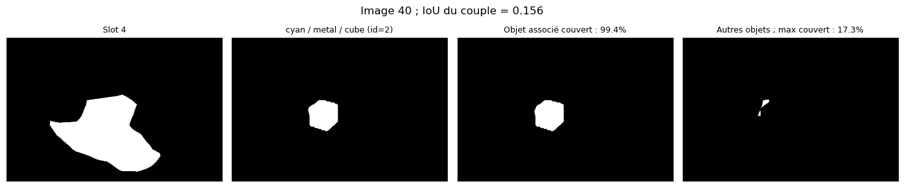
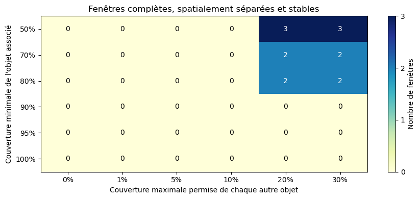

# MVA Robotics Project : Can C-JEPA Identify the Collision Partner ? 

-> forked repo from: https://github.com/galilai-group/cjepa

## Abstract 

Causal-JEPA  ( C-JEPA ) learns a World Model through an object-level latent masking to encourage a causal inductive bias directly trough the learning objective. C-JEPA is closing the gap with Dino-wm in push-T planning benchmark with ~1% token usage compare to Dino-wm. This suggest a well factorize learned latent space but the nature of the learned dynamic is still unclear. Did C-JEPA captured some causal bias ? More generally if we hide the actor object of a collision in the history, will the prediction of C-JEPA fall appart ? We use CLEVRER dataset to mask different object one by one in various videos from the val set and try to understand if C-JEPA can identify the collision partner. 

## 1. Link the slots to the objects

Object encoder = videoSAUR. Slots decoding shows large patches, usually covers more than simply the object zone. The object zone in given by the annotations of CLEVRER dataset in pixel space. We can compute the intersection of the decoded $Slot_i$ and the all the object's masks to see what object it represents. 
Example: For a fixed frame F.If the zone obtained by decoding $Slot_i$ covers 100% of the zone given by the mask of the object j, we can assume that $Slot_i$ represent the object j. 

## 2. Check consistency accros time of link: object <--> Slot

We are using the validation set of CLEVRER, which is around 5k videos. But we have to make some choices to select the videos that are allowing us to make a clean benchmark here. 
We are constructing windows as follow: If collision if at frame T, we keep the history video[T-H : T-1] and the futur the predict video[ T: T+L ]. Their are few conditions to check to see if the window is safe : 
1. Slots needs to stay consitent accros time. This should be ok
2. Make sure that the slot is not leaking too much on another object. When we decode slots we see that it can be very wide, and cover other areas. What we want is to mask only the object that the slot is covering, not something else. So we have to choose a treshold for the 2nd object coverage uppon which we consider the window not safe. See example above, the real object is cover at 99.4% which is really nice. But another one is 17.3% covered ! Not nice 

For this we can compute a sort of matrix like following to preprocess an the validation set and then choose treshold ( very simple example on very few windows here ) : 

Ideally, we want the highest % of the main object, and the lower % for the maximal second object coverage. 

## 3. Code the Ablation

Once we have the preprocessed dataset: X windows centred on a collision event with consitent slot representing the right object and no coverage of other objects uppen a certain treshhold --> we can code the ablation. 

The Ablation is simple. For a given window. For every objects, mask the $object_i$ in the history, predict the next frames, save the error of prediction. Annotations of CLEVRER give which object is responsible of the collision. So we should observe the highest prediction error for the collision partner masking. 
